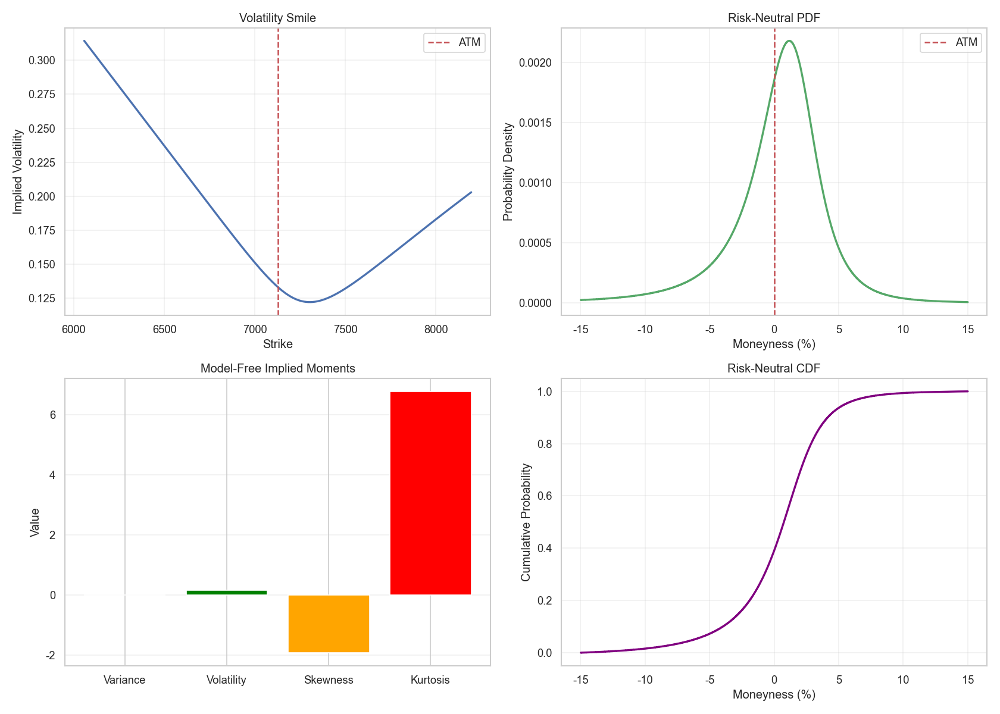
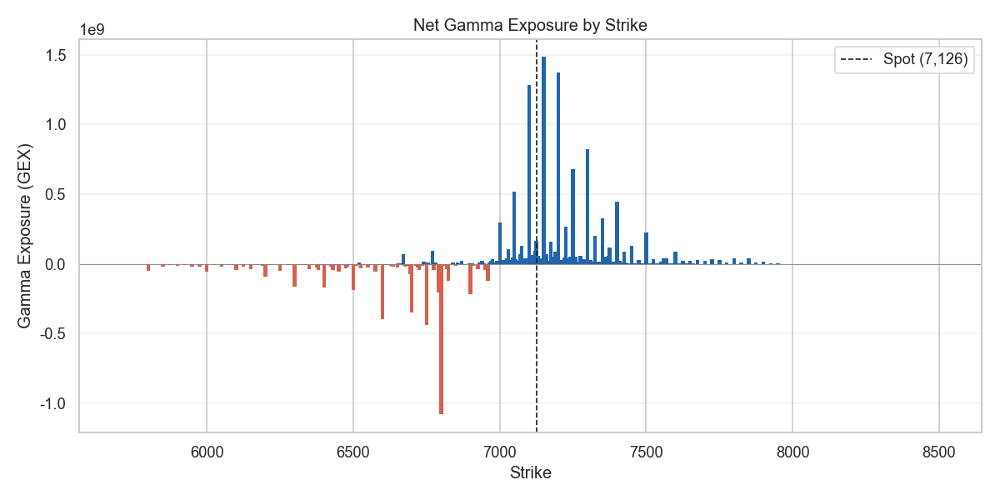
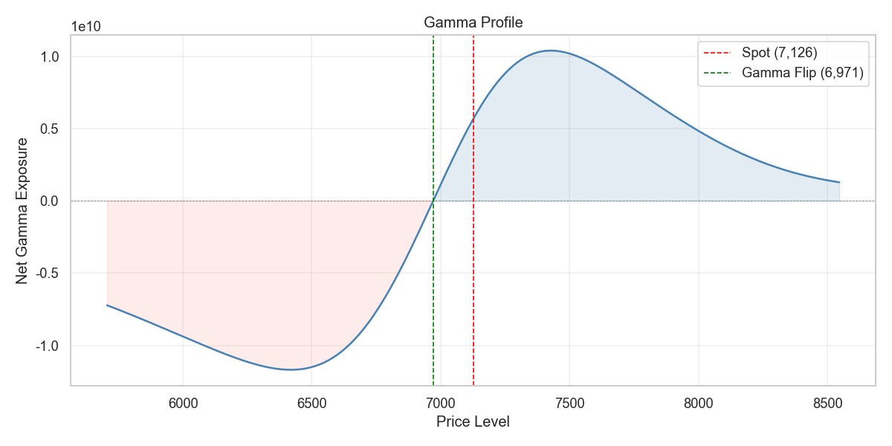
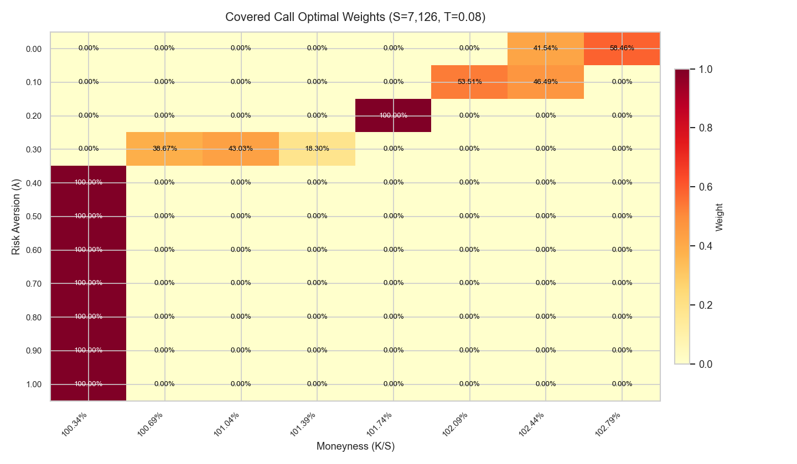

# option probability portfolio

Extract risk-neutral probability distributions from option chains and optimize covered call strike allocation using Monte Carlo simulation.

---

## Pipeline

```
Option Chain → IV Surface Fitting → Breeden-Litzenberger PDF → Monte Carlo Sampling → Covered Call Optimization
                (SABR / SVI)           ∂²C/∂K²                  (Inverse CDF)            Mean-Variance
                                                          (optional: Q → P tilt, calib/)  (QP exact solve)
```

## Core Mathematics

### 1. Implied PDF (Breeden-Litzenberger)

$$q(K) = e^{rT} \frac{\partial^2 C}{\partial K^2}$$

Fit the IV surface via SABR or SVI, then recover the risk-neutral density through finite differences on a dense strike grid. Butterfly and call-spread arbitrage conditions are enforced before extraction.

### 2. Model-Free Implied Moments (Bakshi-Kapadia-Madan 2003)

$$V = 2\int \frac{1 - \ln(K/F)}{K^2} \cdot O(K)\,dK, \quad W = \int \frac{6\ln(K/F) - 3\ln^2(K/F)}{K^2} \cdot O(K)\,dK$$

Compute variance, skewness, and kurtosis directly from OTM option prices — no model assumptions required.

### 3. Covered Call Objective

$$\min_{\mathbf{x}} \; -(1-\lambda)\,\mathbb{E}[R] + \lambda\,\text{Var}[R] + \eta\,\text{Var}_{\text{timing}}[R]$$

Terminal prices $S_T$ are sampled directly from the implied PDF via inverse CDF sampling. Following Israelov & Nielsen (2015), the covered call return is decomposed into passive equity, short volatility, and dynamic equity (equity timing) components. The timing variance term penalizes uncompensated equity reversal exposure arising from option convexity.

### 4. Q → P Calibration (`calib/`)

Under Q the expected return of a covered call collapses to carry, so the optimizer sees no edge. The sampled density is tilted with a pricing-kernel power:

$$p(K) \propto q(K)\,(K/F)^{\gamma}$$

$\gamma$ is a pipeline-bound correction parameter (not a risk-aversion coefficient), fitted by maximum likelihood on past $(q_t, S_T)$ pairs using only pairs settled before the decision date (`as_of`, point-in-time). Models share one interface (`BaseERModel`): `PooledGamma` (one $\gamma$), `RegimeGamma` (per regime), `ShrunkRegimeGamma` (per-regime $\gamma$ shrunk toward the pooled value by DerSimonian-Laird random effects), `KappaRegime` (pooled $\gamma$ plus a per-regime volatility scale), `QMeasure` (no correction).

## Usage

```python
from pdf import OptionImpliedPDF
from optim import BuyWriteOptimizer

# 1. Extract implied PDF
model = OptionImpliedPDF(option_chain_df, rf=0.035, dividend=0.0138)
model.fit(method='sabr', mny_bounds=(0.15, 0.15), check_arbitrage=True)

# 2. Optimize covered call
optimizer = BuyWriteOptimizer(Ks=model.Ks, S=model.S, T=T, r=rf)
optimizer.fit(pdfs=model.pdf.values, N=100_000)
weights = optimizer.optimize(
    price=model.price,
    mnys=target_strikes / S,
    risk_aversion=np.arange(0.1, 1.0, 0.1),
)
```

Q → P calibration and fixed-lambda optimization (see `example_qp_calib.py` for a runnable version):

```python
from calib import ERDataset, PooledGamma
from optim.candidates import select_candidates

# records: [{'Ks': ..., 'pdf': ..., 'ST': realized settlement, 'settle_day': Timestamp}, ...]
ds = ERDataset(records)
er_model = PooledGamma().fit(ds, as_of=decision_date)      # only pairs settled on/before as_of are used
optimizer.fit(pdfs=model.pdf.values, N=100_000, er_model=er_model)

# restrict candidates (ATM or above, delta >= 0.10) and set lambda directly; tcr=None also optimizes the cover ratio
ix = select_candidates(strikes, call_deltas, S, min_moneyness=1.0, min_delta=0.10, max_n=30)
sol = optimizer.optimize_fixed_lambda(strikes[ix], call_mids[ix], lams=[0.0, 0.5], tcr=1.0)
```

`calib/dataset.py` (building the (q_t, S_T) dataset from a daily chain archive) reads its inputs from environment variables: `OPP_CHAIN_DIR` (daily chain CSVs as `{yyyy}/{yyyymmdd}.csv`) and `OPP_DATA_ROOT` (project providing `preprocess.DataLoader` for rates and dividends). `calib/labels.py` reads an optional regime file from `OPP_MACRO_REGIME_PATH`.

## Key Features

- **IV Surface Fitting**: SABR, SVI, and PCHIP interpolation with automatic arbitrage detection and correction
- **Implied PDF Sampling**: Inverse CDF sampling from the risk-neutral density with trapezoid integration
- **Mean-Variance Optimization**: Risk aversion sweep across strike allocations with total cover ratio constraint
- **Solver Options**: Exact convex QP (default; SLSQP with a Frank-Wolfe duality-gap check), brute-force Monte Carlo (parallelized), or COBYLA with warm-start across risk aversion levels
- **Q → P Calibration**: Point-in-time pricing-kernel exponent (pooled / per-regime / shrunk) so expected returns are not just carry
- **Fixed-Lambda Mode**: Delta-band candidate selection and direct lambda, with free or fixed cover ratio
- **Greeks Monitor**: GEX, VEX, gamma/vanna profiles, and flip point computation

## Output Examples

### Implied PDF Diagnostics


### Net Gamma Exposure by Strike


### Gamma Profile


### Covered Call Optimal Weights


## References

- Breeden & Litzenberger (1978) — *Prices of State-Contingent Claims Implicit in Option Prices*
- Bakshi, Kapadia & Madan (2003) — *Stock Return Characteristics, Skew Laws, and Differential Pricing*
- Hagan et al. (2002) — *Managing Smile Risk* (SABR)
- Gatheral & Jacquier (2014) — *Arbitrage-Free SVI Volatility Surfaces*
- Israelov & Nielsen (2015) — *Covered Calls Uncovered* (equity timing decomposition)
- DerSimonian & Laird (1986) — *Meta-Analysis in Clinical Trials* (random-effects shrinkage)

## License

MIT
